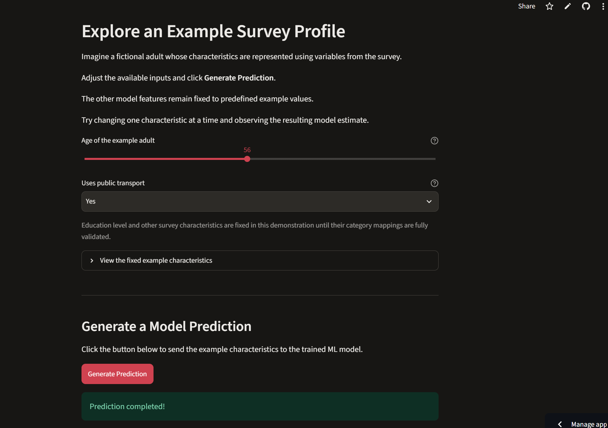
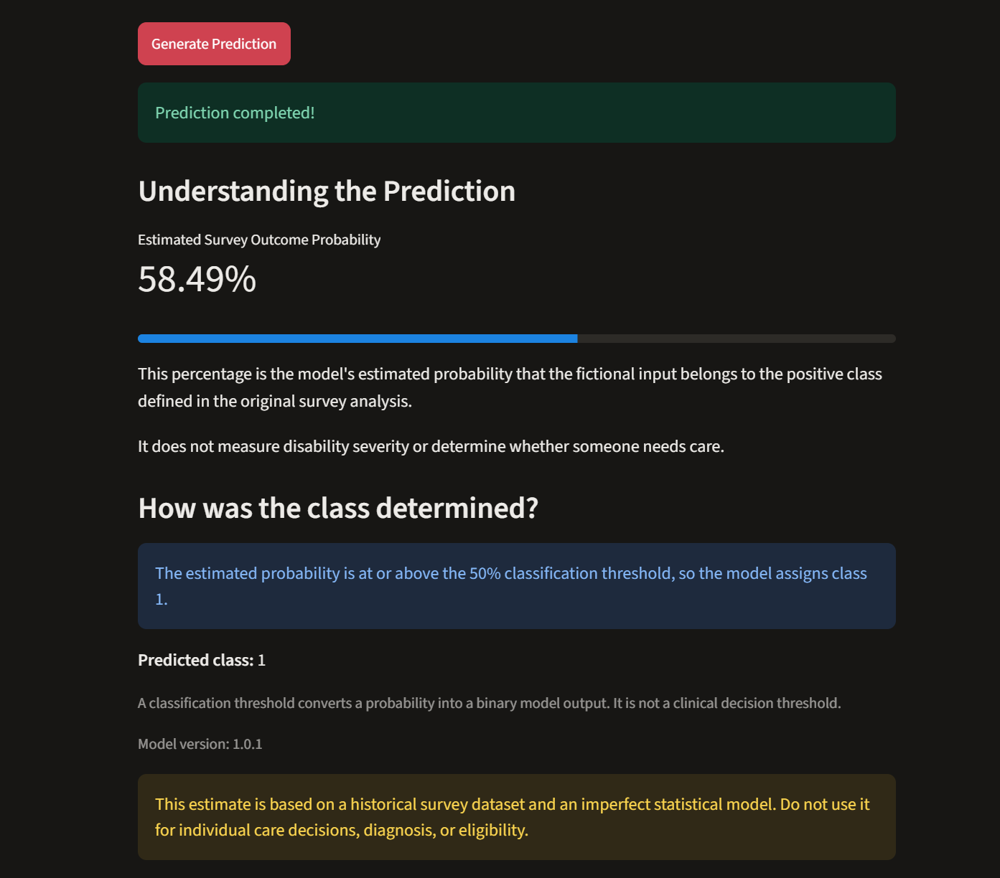
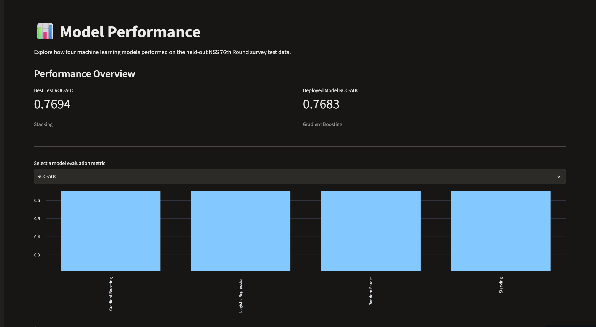
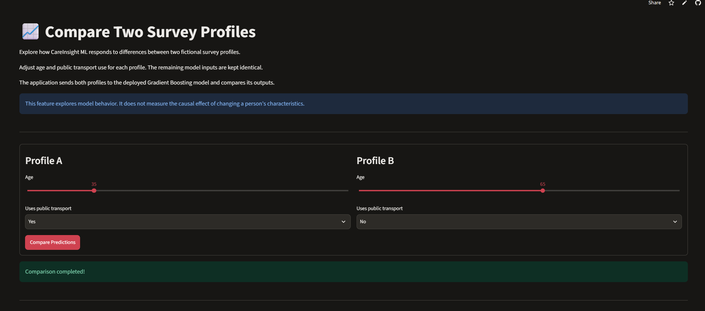
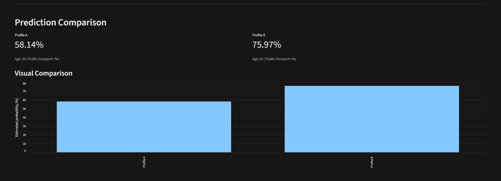
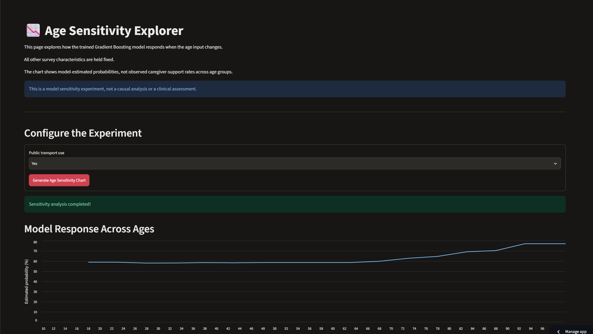
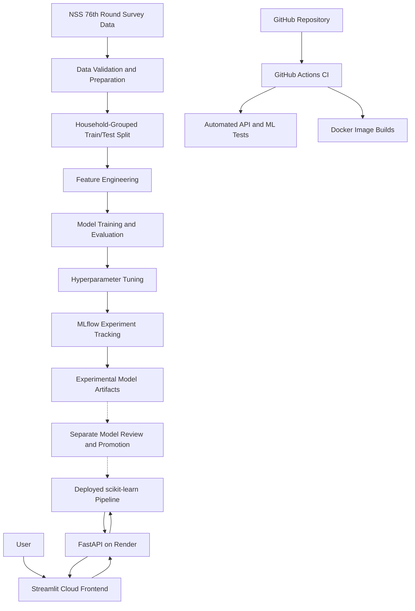

# 🧠 CareInsight ML

### End-to-End Machine Learning & MLOps Application

**An interactive machine learning research platform exploring caregiver-support patterns among adults with disabilities in India.**

[🌐 Live Application](https://careinsight-mlops.streamlit.app/) |
[⚡ FastAPI Documentation](https://careinsight-api.onrender.com/docs) |
[🔄 GitHub Actions](https://github.com/macrosensor2022/careinsight-mlops/actions) |
[📘 Training Guide](TRAINING.md) |
[📋 Model Card](MODEL_CARD.md)

**---**

## 1. Project Overview

CareInsight ML is an end-to-end machine learning and MLOps project built using India's National Sample Survey (NSS), 76th Round disability survey.

The project investigates whether demographic, disability-related, household, and accessibility characteristics can help predict a survey-defined caregiver-arrangement outcome.

Beyond model training, CareInsight demonstrates how to develop, validate, containerize, test, and deploy machine learning systems.

### Key Capabilities

- Machine learning model training and evaluation
- Data preparation and feature engineering
- Household-aware train/test splitting
- Hyperparameter optimization
- MLflow experiment tracking
- REST API-based model inference
- Interactive Streamlit application
- Docker containerization
- Automated testing with GitHub Actions
- Cloud deployment using Render and Streamlit

> **Research Disclaimer:** CareInsight ML is an educational research application. It is not a medical diagnosis, clinical assessment, or individual care eligibility tool.

**---**

### Application Preview

#### 1. Interactive Prediction

Enter fictional survey characteristics:



View the model's prediction:



#### 2. Model Performance Dashboard

Explore the historical evaluation of four machine learning models.



#### 3. Compare Profiles

Compare two fictional profiles:



View the comparison results:



#### 4. Age Sensitivity Explorer

Explore how predictions change across age values while other inputs remain fixed.



---


## 2. Problem Statement

Caregiver arrangements are an important dimension of disability-related research.

Large-scale surveys collect information about individuals, households, disability characteristics, access to public services, and support arrangements.

Machine learning can help identify statistical patterns associated with recorded survey outcomes.

CareInsight explores the following research question:

**Can selected characteristics from the NSS 76th Round survey help predict a binary caregiver-arrangement outcome?**

The objective is to:

1. Prepare survey data for machine learning.
2. Identify potentially informative features.
3. Compare different classification algorithms.
4. Evaluate predictive performance on held-out data.
5. Deploy an interactive demonstration.
6. Build a reproducible ML engineering workflow.

The current target is derived from the original notebook's caregiver-code transformation. Its precise real-world interpretation requires verification against the official survey codebook.

**---**

## 3. Live Application

### Try CareInsight ML

https://careinsight-mlops.streamlit.app/

The application provides five interactive sections.

### Explore Predictions

Visitors can modify selected characteristics of a fictional survey profile and generate a prediction through the deployed Gradient Boosting model.

The interface explains the returned probability, predicted class, and relevant limitations.

### Model Performance

Compares historical evaluation results across:

- Logistic Regression
- Random Forest
- Gradient Boosting
- Stacking

Visitors can explore ROC-AUC, precision, recall, F1 score, and train-test differences.

### Behind the Model

Explains the machine learning development workflow, architecture, deployment infrastructure, and responsible-use limitations.

### Compare Profiles

Allows visitors to compare the estimated outcomes of two fictional profiles.

The visual comparison demonstrates how the trained model responds to different input combinations.

### Age Sensitivity Explorer

Visualizes how model predictions vary across selected age values while holding the remaining characteristics constant.

This is a model-sensitivity experiment, not evidence of a causal relationship.

**Important:** The interactive application uses fictional input combinations. It is not intended for decisions about real individuals.

**---**

## 4. Dataset

### Source

**National Sample Survey (NSS), 76th Round — Disability Survey, India**

Survey period: July–December 2018.

The local training workflow uses six survey CSV files containing demographic, household, disability, caregiver-arrangement, activity, and assistance-related information.

### Data Preparation

The workflow performs:

1. Verification of source files.
2. Inspection of dataset schemas.
3. Household- and person-level record merging.
4. Age validation.
5. Target construction.
6. Feature engineering.
7. Household-grouped training/test splitting.

### Prepared Dataset

| Description | Count |
|---|---:|
| Adult records before final age validation | 89,340 |
| Adult records after cleaning | 89,338 |
| Training records | 71,516 |
| Testing records | 17,822 |
| Selected model features | 14 |

### Selected Features

The deployed model uses:

1. `dis_seeing`
2. `dis_loss_sensation`
3. `dis_understanding`
4. `dis_hearing`
5. `uses_public_transport`
6. `multiple_disability`
7. `principal_activity_status`
8. `dis_deformity`
9. `dis_anxiety_mood`
10. `relation_to_head`
11. `age`
12. `education_level`
13. `accesses_public_building`
14. `log_monthly_exp`

The feature list was obtained from the original research experiment and is reused in the current reproducible training scripts.

Raw survey data and processed person-level records are excluded from Git version control.

**---**

## 5. Machine Learning Methodology

### Data Cleaning and Feature Engineering

The processing workflow includes:

- Survey-code validation
- Binary feature recoding
- String representation of nominal survey categories
- Log transformation of monthly expenditure
- Multiple-disability feature construction
- Missing-value handling through scikit-learn pipelines

### Train/Test Strategy

The workflow uses `StratifiedGroupKFold` with household identifiers to create an approximately 80/20 train/test split.

This prevents individuals from the same household from appearing in both training and test partitions.

The split uses a fixed random state for repeatable execution.

### Preprocessing

A scikit-learn `ColumnTransformer` processes feature groups using:

**Numeric features**

- Median imputation
- Standard scaling

**Nominal categorical features**

- Most-frequent imputation
- One-hot encoding
- Handling of infrequent or previously unseen categories

**Binary indicators**

- Survey-code transformations
- Passthrough into the model pipeline

The preprocessing steps are fitted using the training data.

### Algorithms Evaluated

The original research notebook evaluated:

- Logistic Regression
- Random Forest
- Histogram-based Gradient Boosting
- Stacking Classifier

### Feature Selection

The original research examined feature-selection methods including mutual information, sequential selection, and L1-regularized logistic regression.

The current independent training pipeline reuses the resulting 14 selected features.

A complete independent reproduction and leakage audit of the original feature-selection procedure remains future work.

**---**

## 6. Original Model Evaluation

The following metrics were recorded in the original research notebook.

### Historical Held-Out Test Results

| Model | ROC-AUC | F1 | Precision | Recall |
|---|---:|---:|---:|---:|
| Logistic Regression | 0.7628 | 0.7386 | 0.7992 | 0.6866 |
| Random Forest | 0.7678 | 0.7379 | 0.8063 | 0.6802 |
| Gradient Boosting | 0.7683 | 0.7344 | 0.8114 | 0.6707 |
| Stacking | **0.7694** | 0.7361 | 0.8101 | 0.6745 |

### Deployed Model

**Histogram-based Gradient Boosting**

Although Stacking achieved the highest historical test ROC-AUC, Gradient Boosting delivered nearly identical discrimination with a simpler inference pipeline.

The deployed model is stored as a serialized scikit-learn pipeline and served through FastAPI.

The evaluation metrics above are historical test results, not continuously measured production performance.

For model assumptions, training-serving consistency, and responsible use, see the [Model Card](MODEL_CARD.md).

**---**

## 7. Reproducible Model Training

CareInsight includes a Python-based training workflow that reconstructs data preparation, preprocessing, model training, and evaluation using the original survey files.

### Training Workflow

```text

NSS Survey CSV Files

         |

         v

Dataset Verification

         |

         v

Survey Table Merging

         |

         v

Target Construction

         |

         v

Household-Grouped Split

         |

         v

Feature Engineering

         |

         v

Baseline Gradient Boosting

         |

         v

Hyperparameter Tuning

         |

         v

Model Evaluation

         |

         v

MLflow Experiment Tracking

```

### Run the Training Workflow

Place the original NSS survey CSV files inside:

`data/raw/`

Install the required Python dependencies in a compatible environment.

Then execute the following commands from the repository root:

```bash

python -m ml.validate_data

python -m ml.inspect_data

python -m ml.prepare_data

python -m ml.create_split

python -m ml.feature_engineering

python -m ml.train

python -m ml.tune

```

The training scripts produce experimental models under:

`experiments/`

These models are separate from the production model.

The workflow does not automatically overwrite or redeploy the model used by the public application.

For more details, see:

[Training and Reproducibility Guide](**&#x54;RAINING.m&#x64;**)

**---**

## 8. Independent Training Experiments

In addition to the original research notebook, two Gradient Boosting models were trained using the Python workflow.

### Experimental Results

| Metric | Baseline GB | Tuned GB |
|---|---:|---:|
| Accuracy | 0.6987 | 0.6985 |
| Precision | 0.8128 | 0.8135 |
| Recall | 0.6619 | 0.6606 |
| F1 Score | 0.7296 | 0.7291 |
| Test ROC-AUC | 0.7677 | **0.7686** |

### Hyperparameter Optimization

The new tuning experiment uses:

- `RandomizedSearchCV`
- `StratifiedGroupKFold`
- Three household-grouped cross-validation folds
- Six randomly sampled hyperparameter configurations
- ROC-AUC optimization
- Random state 42

### Best Hyperparameters

| Parameter | Selected Value |
|---|---:|
| Learning rate | 0.05 |
| Maximum iterations | 150 |
| Maximum leaf nodes | 31 |
| Minimum samples per leaf | 60 |
| L2 regularization | 0.0 |

**Best cross-validation ROC-AUC:** 0.7646

**Held-out test ROC-AUC:** 0.7686

The tuned model achieved a small improvement over the baseline. The result does not independently establish statistically meaningful superiority.

This limited tuning experiment does not claim exact reproduction of the original notebook's full search procedure.

**---**

## 9. MLflow Experiment Tracking

MLflow is used to track machine learning experiments, parameters, metrics, and model artifacts.

### Recorded Experiments

Experiment:

`CareInsight-Reproducible-Training`

Runs:

- `reproducible_baseline_gb`
- `reproducible_tuned_gb`

### Tracked Information

- Model algorithm
- Training configuration
- Hyperparameters
- Cross-validation ROC-AUC
- Training metrics
- Held-out test metrics
- Saved experimental model artifacts
- Experiment metadata

### Start MLflow Locally

```bash

docker compose up -d mlflow

```

Open:

http://localhost:5000

To log the previously saved experimental results:

```bash

python -m ml.log_training_runs

```

Each execution creates new MLflow runs.

The experiment tracking server is local and is not publicly exposed through the Streamlit website.

The experimental model files are logged as run artifacts rather than registered production models.

**---**

## 10. System Architecture



*The dashed model-promotion path is conceptual; it is not an automated production deployment.*

### Cloud Inference Architecture

```text

             End User

                |

                v

     Streamlit Community Cloud

          (Frontend UI)

                |

                | HTTPS Request

                v

        Render Web Service

           (FastAPI API)

                |

                v

       scikit-learn Pipeline

          (Saved Model)

                |

                v

        Prediction Response

                |

                v

         Streamlit Results

```

### Development and MLOps Workflow

```text

     NSS Survey Data

            |

            v

      Python Training

            |

            v

       Model Evaluation

            |

            v

      MLflow Tracking

            |

            v

      Model Artifacts

--------------------------------

    GitHub Repository

            |

            v

     GitHub Actions CI

            |

       +----+----+

       |         |

       v         v

   API Tests  Docker Builds

--------------------------------

    Docker Compose

            |

      +-----+-----+

      |     |     |

      v     v     v

   FastAPI  UI  MLflow

```

### Deployment

**Frontend:** Streamlit Community Cloud

**Backend:** Render Web Service

**Local development:** Docker Compose

**Source control:** GitHub

**Continuous integration:** GitHub Actions

GitHub Actions tests and builds the project. Deployment is managed separately by the connected cloud-hosting services.

**---**

## 11. Technology Stack

| Layer | Technologies |
|---|---|
| Programming | Python |
| Data Processing | pandas, NumPy |
| Machine Learning | scikit-learn |
| Model Serialization | Joblib |
| API Development | FastAPI, Pydantic, Uvicorn |
| User Interface | Streamlit |
| Experiment Tracking | MLflow |
| Containerization | Docker, Docker Compose |
| Automated Testing | pytest, FastAPI TestClient |
| Continuous Integration | GitHub Actions |
| Backend Hosting | Render |
| Frontend Hosting | Streamlit Community Cloud |
| Version Control | Git, GitHub |

**---**

## 12. Repository Structure

```text

careinsight-mlops/

|

├── api/

│   └── main.py

|

├── app/

│   ├── streamlit_app.py

│   ├── requirements.txt

│   └── pages/

│       ├── 1_Model_Performance.py

│       ├── 2_Behind_the_Model.py

│       ├── 3_Compare_Profiles.py

│       └── 4_Age_Sensitivity.py

|

├── ml/

│   ├── validate_data.py

│   ├── inspect_data.py

│   ├── prepare_data.py

│   ├── create_split.py

│   ├── feature_engineering.py

│   ├── train.py

│   ├── tune.py

│   ├── log_training_runs.py

│   └── other MLflow utilities

|

├── models/

│   ├── caregiver_model.joblib

│   └── selected_features.joblib

|

├── reports/

│   └── model_comparison.csv

|

├── tests/

│   ├── test_api.py
│   └── test_ml_pipeline.py

|

├── docker/

│   ├── Dockerfile.api

│   ├── Dockerfile.frontend

│   └── Dockerfile.mlflow

|

├── .github/

│   └── workflows/

│       └── ci.yml

|

├── compose.yaml

├── requirements.txt

├── requirements-api.txt

├── requirements-frontend.txt

├── TRAINING.md

├── .gitignore

└── README.md

```

The original dataset and experimental training artifacts remain outside Git version control.

**---**

## 13. Run the Application Locally

### Prerequisites

- Git
- Docker Desktop
- Docker Compose

### Clone the Repository

```bash

git clone https://github.com/macrosensor2022/careinsight-mlops.git

cd careinsight-mlops

```

### Build and Start Services

```bash

docker compose up -d --build

```

### Local Services

| Service | URL |
|---|---|
| Streamlit Application | http://localhost:8501 |
| FastAPI Documentation | http://localhost:8000/docs |
| FastAPI Health Check | http://localhost:8000/health |
| MLflow Dashboard | http://localhost:5000 |

### Stop Services

```bash

docker compose down

```

Docker Compose manages the local application services.

The public cloud deployment operates independently of the local Docker environment.

**---**

## 14. FastAPI Prediction Service

The FastAPI backend exposes:

| Endpoint | Method | Purpose |
|---|---|---|
| `/` | GET | API information |
| `/health` | GET | Model service health |
| `/features` | GET | Required input features |
| `/predict` | POST | Generate a model prediction |

The `/predict` endpoint accepts the selected feature values and returns:

- Estimated positive-class probability
- Predicted binary class
- Model version

### Training–Serving Consistency

During development, a categorical feature representation mismatch was identified.

The original model preprocessing expected string-coded nominal categories, while the initial API passed numeric values.

The backend was corrected to align these features with their training representation.

Regression tests were updated to check the corrected inference result.

This correction is included in the deployed API version 1.0.1.

**---**

## 15. Automated Testing and CI

CareInsight uses pytest and GitHub Actions to validate application changes.

### Automated Checks

- API health response
- Required feature schema
- Rejection of incomplete inputs
- Reference prediction regression test
- Rejection of fractional nominal category codes
- Feature engineering transformations and input validation
- Python syntax validation
- FastAPI Docker image build
- Streamlit Docker image build

### Run All Tests Locally

```bash

python -m pytest tests/ -v

```

### Run Syntax Checks

```bash

python -m compileall -q api app ml tests

```

### CI Workflow

The GitHub Actions workflow runs on configured pushes and pull requests.

It installs dependencies, validates Python syntax, runs API and ML feature-engineering tests, and builds Docker images.

[View GitHub Actions](https://github.com/macrosensor2022/careinsight-mlops/actions)

The CI workflow does not retrain models because the original survey datasets are not included in the GitHub repository.

**---**

## 16. Prediction Interpretation

The application returns an estimated probability for the positive class defined by the original training target.

### What the Probability Represents

A model output of 0.58 indicates an estimated 58% probability assigned to the positive model class for the supplied feature combination.

It does not mean:

- A person has a 58% disability severity.
- A person requires 58% of a caregiver.
- A clinical decision should be made.
- Caregiver support would change by a certain percentage if an input changed.

### Binary Classification

The deployed API uses a 0.50 classification threshold.

- Probability below 0.50: Class 0
- Probability at or above 0.50: Class 1

The threshold is a model decision rule, not a clinical threshold.

Probability calibration has not been independently established.

**---**

## 17. Research Limitations and Responsible Use

CareInsight is an educational machine learning project.

### Known Limitations

**Historical data**

The model was trained using data from the NSS 76th Round survey. Generalization to contemporary populations has not been established.

**Target interpretation**

The original target was constructed from caregiver survey codes. The exact meaning of the positive class requires official codebook verification.

**Synthetic profiles**

Interactive examples use fictional input combinations that may not represent realistic survey participants.

**Limited input validation**

Survey code mappings and supported interactive inputs require further validation.

**Statistical associations**

Differences in predictions do not demonstrate causal effects.

**Model performance**

A test ROC-AUC near 0.77 indicates imperfect discrimination.

**Probability calibration**

Predicted probabilities have not been validated as calibrated individual-level risks.

**Fairness and subgroup evaluation**

Comprehensive subgroup performance and fairness assessments remain future work.

### Intended Use

- Educational machine learning exploration
- Demonstration of model deployment
- Examination of model behavior
- MLOps portfolio demonstration

### Not Intended For

- Medical diagnosis
- Individual caregiver eligibility decisions
- Clinical treatment decisions
- Disability assessment
- Decisions affecting access to support services

**---**

## 18. Future Improvements

Planned improvements include:

- Verify the official survey caregiver-code definitions.
- Independently reproduce feature selection on training data.
- Audit feature leakage and split methodology.
- Pin and document model-training dependencies.
- Record dataset provenance and checksums.
- Evaluate predicted probability calibration.
- Perform subgroup and fairness evaluation.
- Add automated data-quality checks.
- Improve production inference monitoring.
- Expand user inputs using validated survey category mappings.

**---**

## 19. Project Links

**Live Streamlit Application**

https://careinsight-mlops.streamlit.app/

**FastAPI Documentation**

https://careinsight-api.onrender.com/docs

**GitHub Actions**

https://github.com/macrosensor2022/careinsight-mlops/actions

**Training Guide**

[TRAINING.md](TRAINING.md)

**---**

## 20. Project Focus

CareInsight ML demonstrates practical experience in:

- Machine Learning Engineering
- Data Preparation and Feature Engineering
- Model Training and Evaluation
- Hyperparameter Optimization
- API Development
- MLOps and Experiment Tracking
- Docker and Containerization
- Automated Testing and CI
- Cloud Deployment
- Responsible ML Interpretation

**CareInsight ML — From Survey Data to a Cloud-Deployed Machine Learning Application.**
